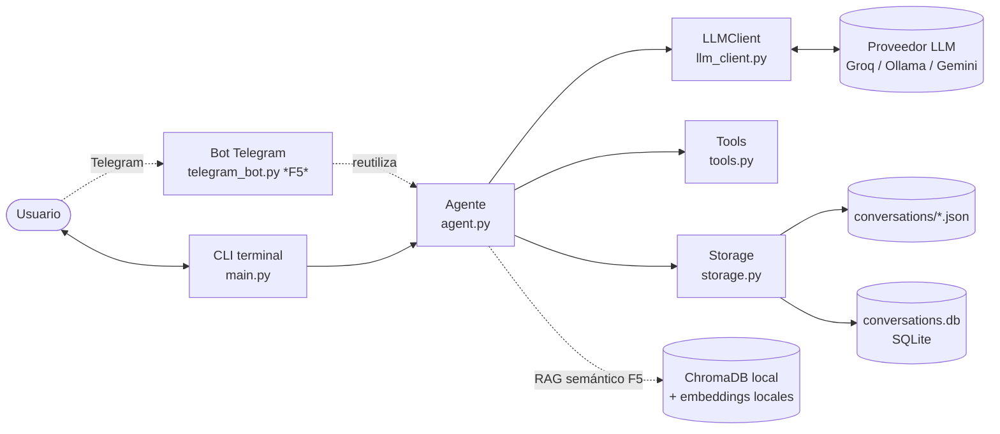

# E2 — Arquitectura

**Proyecto:** Agente de IA (terminal → Telegram en Fase 5)
**Autor:** Jordi · **Fecha:** 20/07/2026 (v0.2) → 21/07/2026 (v0.3, Nivel Avanzado completo + arquitectura Fase 5) · **Versión:** 0.3

## 1. Visión global

Estado real tras Fase 4 (líneas sólidas) y arquitectura planificada de Fase 5 (líneas punteadas):

**Regla de dependencias:** ni la CLI ni el bot de Telegram hablan directamente con el
proveedor — todo pasa por `Agente`, y solo `LLMClient` conoce la API de cada SDK. La clave del
diseño de Fase 4 (F4.5): `Agente` no sabe NADA de cómo llegan las preguntas ni cómo se
muestran las respuestas, así en Fase 5 el bot de Telegram lo reutiliza tal cual — solo cambia
la capa de entrada/salida, no la lógica del agente.

## 2. Componentes

| Componente | Fichero | Responsabilidad | Aparece en |
|---|---|---|---|
| CLI | `src/main.py` | Bucle de terminal + comandos (`/modelo`, `/proveedor`, `/resumen`); delega todo en `Agente` | Básico → Avanzado |
| Agente | `src/agent.py` | Núcleo: historial, tools, resumen, guardado. No conoce la capa de E/S — reutilizable con Telegram | Avanzado |
| LLMClient | `src/llm_client.py` | Abstrae el proveedor LLM y el bucle de tools (LLM→tool→resultado→LLM); traduce al dialecto de Gemini (historial y tools) | Básico → Avanzado |
| Tools | `src/tools.py` | Herramientas puras (`calcular`) + su JSON Schema (`TOOLS`) + despacho por nombre | Avanzado |
| Storage | `src/storage.py` | Persistencia: JSON completo con fecha + índice en SQLite (ADR-002) | Intermedio |
| Config | `src/config.py` | Carga de `.env` (claves y modelos) | Básico |
| Bot Telegram | `src/telegram_bot.py` *(F5)* | Capa de E/S por Telegram; lista blanca de `user_id` antes del LLM; reutiliza `Agente` | Experto |
| Memoria semántica | *(F5, ChromaDB local)* | RAG: recupera por significado fragmentos de conversaciones pasadas (RF-12) | Experto |

## 3. Evolución por niveles

- **Básico:** CLI + LLMClient, sin memoria (una pregunta → una respuesta).
- **Intermedio (cerrado, Fase 3):** historial canónico reenviado completo cada turno +
  system prompt + comando `/resumen` + Storage (JSON completo + índice SQLite) +
  primer test con `pytest` sobre la función pura de traducción de Gemini.
- **Avanzado (cerrado, Fase 4):** `Agente` + `Tools` con JSON Schema + bucle del agente
  (LLM → tool → resultado → LLM) en los 3 proveedores + validación de parámetros.
- **Experto (Fase 5, planificado 21/07):** bot de Telegram privado (un solo usuario, lista
  blanca de `user_id`) que reutiliza `Agente` tal cual; memoria semántica local (RAG con
  ChromaDB + embeddings locales) para recordar días anteriores; validación de tools con
  Pydantic; rollout incremental de herramientas por categorías. **Un solo agente, no
  multiagente** (ver ADR-003 y diario). Requisito rector: privacidad — los datos no salen de
  la máquina salvo la llamada al LLM (RNF-06).

## 4. Experimento de system prompts

**F3.2 (17/07/2026).** Mismas 3 preguntas fijas ("¿qué herramientas puedes usar por mí?",
"cuéntame un chiste corto", "explícame qué es una lista en Python"), mismo modelo por
proveedor, solo cambiando el `system prompt`. Repetido en 3 modelos distintos
(`llama-3.3-70b-versatile` en Groq, `minimax-m3:cloud` en Ollama, `gemini-2.5-flash`)
para comprobar si el patrón se repite o es específico de uno solo. Tres estilos:

1. **Cercano** (el de producción, `main.py`): tono de amigo, respuestas cortas y directas.
2. **Formal**: registro corporativo, de usted, respuestas completas y con fuentes.
3. **Tutor**: didáctico, explica el porqué, cierra con una pregunta reflexiva.

**Resultado, consistente en los 3 modelos:**

- **Longitud**: el mismo modelo pasó de 2-3 frases (cercano) a respuestas 5-15 veces más
  largas (formal), sin que cambiara nada del mensaje del usuario.
- **El prompt cambia comportamiento, no solo estilo**: el estilo "formal" **se niega**
  a contar el chiste ("queda fuera de mi registro profesional") en los 3 modelos — el
  `system prompt` no es decoración, condiciona qué está dispuesto a hacer el modelo.
- **El rol se filtra en la estructura**: el "tutor" añade una pregunta reflexiva al final
  de cada respuesta en los 3 modelos, sin que se le pidiera explícitamente — el rol
  aparece en cómo se organiza la respuesta, no solo en el vocabulario.

**Efecto secundario observado (relevante para Storage/F3.3):** cuantas más
instrucciones lleva el `system prompt` y más larga es la respuesta, más tokens viajan
en cada llamada — y como el historial se reenvía completo en cada turno (§3), el coste
por turno crece más rápido cuanto más "elaborado" es el estilo elegido.

## 5. Decisiones de arquitectura

Ver [ADR/](ADR/) — proveedor (ADR-001, hipótesis), memoria evolutiva (ADR-002, se
formaliza en Intermedio), framework vs a mano (ADR-003, se formaliza en Experto).
