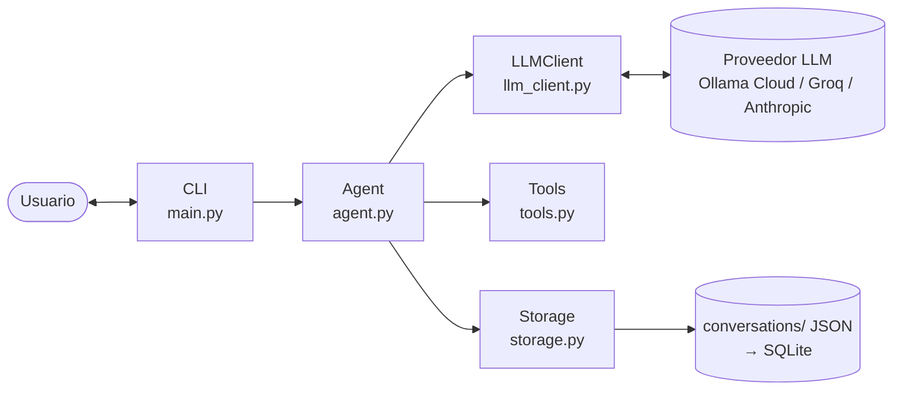

# E2 — Arquitectura

**Proyecto:** Agente de IA en terminal (nombre provisional)
**Autor:** Jordi · **Fecha:** 15/07/2026 · **Versión:** 0.1 — esqueleto; se amplía al cierre de cada nivel

## 1. Visión global

**Regla de dependencias:** la CLI nunca habla directamente con el proveedor; todo pasa
por `Agent`, y solo `LLMClient` conoce la API del proveedor. Así, cambiar de proveedor
es cambiar configuración (`.env`), no reescribir el agente (ver ADR-001).

## 2. Componentes

| Componente | Fichero | Responsabilidad | Aparece en |
|---|---|---|---|
| CLI | `src/main.py` | Bucle de entrada/salida por terminal | Básico |
| Agent | `src/agent.py` | Orquesta: historial, system prompt, bucle de tools | Intermedio/Avanzado |
| LLMClient | `src/llm_client.py` | Abstrae el proveedor LLM (única pieza que conoce su API) | Básico |
| Tools | `src/tools.py` | Herramientas puras de Python + sus JSON Schema | Avanzado |
| Storage | `src/storage.py` | Persistencia: JSON con fecha → SQLite (ADR-002) | Intermedio |
| Config | `src/config.py` | Carga de `.env` (claves y modelos) | Básico |

## 3. Evolución por niveles

- **Básico:** CLI + LLMClient (sin memoria, una pregunta → una respuesta).
- **Intermedio:** + historial completo reenviado + system prompt + Storage (JSON, intro SQLite).
- **Avanzado:** + Tools con JSON Schema + bucle del agente: LLM → tool → resultado → LLM.
- **Experto:** caso de uso completo sobre la temática elegida (límite de decisión: 28/07).

## 4. Experimento de system prompts

**F3.2 (17/07/2026).** Mismas 3 preguntas fijas ("¿qué herramientas puedes usar por mí?",
"cuéntame un chiste corto", "explícame qué es una lista en Python"), mismo modelo por
proveedor, solo cambiando el `system prompt`. Repetido en 3 modelos distintos
(`llama-3.3-70b-versatile` en Groq, `minimax-m3:cloud` en Ollama, `gemini-2.5-flash`)
para comprobar si el patrón se repite o es específico de uno solo. Tres estilos:

1. **Cercano** (el de producción, `main.py`): tono de amigo, respuestas cortas y directas.
2. **Formal**: registro corporativo, de usted, respuestas completas y con fuentes.
3. **Tutor**: didáctico, explica el porqué, cierra con una pregunta reflexiva.

**Resultado, consistente en los 3 modelos:**

- **Longitud**: el mismo modelo pasó de 2-3 frases (cercano) a respuestas 5-15 veces más
  largas (formal), sin que cambiara nada del mensaje del usuario.
- **El prompt cambia comportamiento, no solo estilo**: el estilo "formal" **se niega**
  a contar el chiste ("queda fuera de mi registro profesional") en los 3 modelos — el
  `system prompt` no es decoración, condiciona qué está dispuesto a hacer el modelo.
- **El rol se filtra en la estructura**: el "tutor" añade una pregunta reflexiva al final
  de cada respuesta en los 3 modelos, sin que se le pidiera explícitamente — el rol
  aparece en cómo se organiza la respuesta, no solo en el vocabulario.

**Efecto secundario observado (relevante para Storage/F3.3):** cuantas más
instrucciones lleva el `system prompt` y más larga es la respuesta, más tokens viajan
en cada llamada — y como el historial se reenvía completo en cada turno (§3), el coste
por turno crece más rápido cuanto más "elaborado" es el estilo elegido.

## 5. Decisiones de arquitectura

Ver [ADR/](ADR/) — proveedor (ADR-001, hipótesis), memoria evolutiva (ADR-002, se
formaliza en Intermedio), framework vs a mano (ADR-003, se formaliza en Experto).
