# E2 — Arquitectura

**Proyecto:** Agente de IA (terminal → Telegram en Fase 5)
**Autor:** Jordi · **Fecha:** 20/07/2026 (v0.2) → 21/07/2026 (v0.3, Nivel Avanzado completo + arquitectura Fase 5) →
23/07/2026 (v0.4, Fase 5.0: capa de proveedores normalizada + router de fallback ADR-004) · **Versión:** 0.4

## 1. Visión global

Estado real tras Fase 5.0 (líneas sólidas) y arquitectura planificada del resto de Fase 5
(líneas punteadas):

```mermaid
flowchart LR
    U([Usuario]) <--> CLI[CLI terminal<br/>src/main.py]
    TG[Bot Telegram<br/>telegram_bot.py *F5.2*] -. reutiliza .-> AG
    U -. Telegram .-> TG

    CLI --> AG[Agente<br/>src/agent.py]
    AG --> TOOLS[Tools<br/>src/tools.py]
    AG --> ST[Storage<br/>src/storage.py]
    ST --> JSON[(conversations/*.json)]
    ST --> DB[(conversations.db<br/>SQLite)]
    AG -. RAG semántico F5.3 .-> VEC[(ChromaDB local<br/>+ embeddings locales)]

    AG --> R{{LLMRouter<br/>src/llm_router.py<br/>retry + fallback · ADR-004}}
    R -->|primario| AD1[Adaptador Groq]
    R -. degrada si falla .-> AD2[Adaptador Ollama]
    R -. degrada si falla .-> AD3[Adaptador Gemini]
    AD1 --> API1[(API Groq)]
    AD2 --> API2[(API Ollama)]
    AD3 --> API3[(API Gemini)]
```

**Regla de dependencias:** ni la CLI ni el bot de Telegram hablan directamente con un
proveedor — todo pasa por `Agente`, que a su vez solo conoce al `LLMRouter` (nunca a un
proveedor concreto). El router decide con cuál hablar y en qué orden; solo los adaptadores
de `llm_client.py` conocen la API real de cada SDK (`llm_types.py` y `llm_errors.py` son el
lenguaje común que usan para hablar entre sí, ver §2). La clave del diseño de Fase 4 (F4.5),
que sigue intacta: `Agente` no sabe NADA de cómo llegan las preguntas ni cómo se muestran las
respuestas, así en Fase 5 el bot de Telegram lo reutiliza tal cual — solo cambia la capa de
entrada/salida, no la lógica del agente.

### Router de fallback en acción (ADR-004)

El diagrama de arriba muestra la forma estática (quién depende de quién); este muestra el
**comportamiento real** ante un fallo transitorio — con un ejemplo real del propio historial
de pruebas del proyecto (F4.2, `847 × 293`):

```mermaid
sequenceDiagram
    actor U as Usuario
    participant AG as Agente
    participant R as LLMRouter
    participant P1 as Adaptador Groq<br/>(primario)
    participant P2 as Adaptador Ollama<br/>(fallback)
    participant T as Tools

    U->>AG: "¿cuánto es 847 × 293?"
    AG->>R: responder(historial, tools)
    activate R

    R->>P1: intento 1
    P1--xR: ErrorLimitePeticiones (reintentable)
    Note right of R: espera 1s (backoff exponencial)
    R->>P1: intento 2
    P1--xR: ErrorLimitePeticiones (reintentable)
    Note right of R: espera 2s
    R->>P1: intento 3 (último)
    P1--xR: ErrorLimitePeticiones
    Note over R: reintentos agotados → degrada al siguiente

    R->>P2: intento 1 (nuevo proveedor)
    activate P2
    P2->>T: calcular("847 * 293")
    T-->>P2: 248171
    P2-->>R: "El resultado es 248171"
    deactivate P2

    deactivate R
    R-->>AG: texto (constancia en logs/agente.log:<br/>"respondió el fallback ollama")
    AG-->>U: "El resultado es 248171"
```



Tres cosas que este diagrama deja claras y que el de cajas no puede:
1. **El backoff es exponencial** (1s, 2s...), no un reintento inmediato — evita machacar un
   proveedor que ya está saturado.
2. **Solo se reintenta lo reintentable.** Un `ErrorAutenticacion` (clave inválida) no dispara
   ningún backoff: degrada al siguiente proveedor a la primera, porque reintentar con la misma
   clave mala nunca va a funcionar.
3. **El tool-calling sigue funcionando dentro del proveedor de fallback** — la degradación no
   pierde ni el historial ni la capacidad de usar herramientas, porque cada adaptador ejecuta
   el mismo bucle (ver `_ProveedorLLM.responder()`), solo con distinto SDK por debajo.

## 2. Componentes

| Componente | Fichero | Responsabilidad | Aparece en |
|---|---|---|---|
| CLI | `src/main.py` | Bucle de terminal + comandos (`/modelo`, `/proveedor`, `/resumen`); delega todo en `Agente` | Básico → Avanzado |
| Agente | `src/agent.py` | Núcleo: historial, tools, resumen, guardado. Solo conoce al `LLMRouter`, nunca a un proveedor concreto. No conoce la capa de E/S — reutilizable con Telegram | Avanzado → F5.0 |
| LLMRouter | `src/llm_router.py` | **Nuevo F5.0 (ADR-004).** Cadena de proveedores (primario + fallback ADR-001) con reintentos y backoff exponencial ante fallos transitorios; degrada automáticamente si el primario no responde | F5.0 |
| Adaptadores LLM | `src/llm_client.py` | Un adaptador por proveedor (`_ProveedorGroq/Ollama/Gemini`), cada uno traduce su SDK a la forma neutra de `llm_types.py`; el bucle LLM→tool→resultado→LLM vive **una sola vez** en la clase base `_ProveedorLLM` | Básico → F5.0 |
| Formas neutras | `src/llm_types.py` | **Nuevo F5.0.** `RespuestaLLM`/`ToolCall`: el "idioma común" que usan los 3 adaptadores para hablar con el bucle compartido, sin que este conozca las diferencias de cada SDK | F5.0 |
| Errores tipados | `src/llm_errors.py` | **Nuevo F5.0.** Excepciones (`ErrorAutenticacion`, `ErrorLimitePeticiones`...) en vez de strings `⚠️`; cada una marca si es `reintentable` — de ahí se guía el `LLMRouter` | F5.0 |
| Tools | `src/tools.py` | Herramientas puras (`calcular`, con límite de longitud) + su JSON Schema (`TOOLS`) + despacho por nombre | Avanzado → F5.0 |
| Storage | `src/storage.py` | Persistencia: JSON completo con fecha + índice en SQLite (ADR-002) | Intermedio |
| Config | `src/config.py` | Carga de `.env`; modelo por defecto por proveedor (`obtener_modelo_por_defecto`, F5.0/T5) | Básico → F5.0 |
| Bot Telegram | `src/telegram_bot.py` *(F5.2)* | Capa de E/S por Telegram; lista blanca de `user_id` antes del LLM; reutiliza `Agente` | Experto |
| Memoria semántica | *(F5.3, ChromaDB local)* | RAG: recupera por significado fragmentos de conversaciones pasadas (RF-12) | Experto |

## 3. Evolución por niveles

- **Básico:** CLI + LLMClient, sin memoria (una pregunta → una respuesta).
- **Intermedio (cerrado, Fase 3):** historial canónico reenviado completo cada turno +
  system prompt + comando `/resumen` + Storage (JSON completo + índice SQLite) +
  primer test con `pytest` sobre la función pura de traducción de Gemini.
- **Avanzado (cerrado, Fase 4):** `Agente` + `Tools` con JSON Schema + bucle del agente
  (LLM → tool → resultado → LLM) en los 3 proveedores + validación de parámetros.
- **Fase 5.0 (endurecimiento, cerrado 23/07 — antes de lo planificado, iba para el 05/08):**
  el bucle de tool-calling, duplicado ×3 hasta entonces, pasa a vivir una sola vez sobre
  formas neutras (`llm_types.py`); errores tipados sustituyen al patrón `⚠️` (`llm_errors.py`);
  timeouts en las 3 llamadas de red; **router de fallback con reintentos** (`llm_router.py`,
  ADR-004) que por fin hace real la resiliencia prometida por ADR-001; catálogo de modelos
  re-verificado en vivo. Motivada por una auditoría de seguridad + revisión de código
  externa hechas a propósito antes de tocar el bot de Telegram — detalle en el diario del
  23/07 (el informe de auditoría es un fichero de trabajo privado, no versionado).
- **Experto (Fase 5, planificado 21/07):** bot de Telegram privado (un solo usuario, lista
  blanca de `user_id`) que reutiliza `Agente` tal cual; memoria semántica local (RAG con
  ChromaDB + embeddings locales) para recordar días anteriores; validación de tools con
  Pydantic; rollout incremental de herramientas por categorías. **Un solo agente, no
  multiagente** (ver ADR-003 y diario). Requisito rector: privacidad — los datos no salen de
  la máquina salvo la llamada al LLM (RNF-06).

## 4. Experimento de system prompts

**F3.2 (17/07/2026).** Mismas 3 preguntas fijas ("¿qué herramientas puedes usar por mí?",
"cuéntame un chiste corto", "explícame qué es una lista en Python"), mismo modelo por
proveedor, solo cambiando el `system prompt`. Repetido en 3 modelos distintos
(`llama-3.3-70b-versatile` en Groq, `minimax-m3:cloud` en Ollama, `gemini-2.5-flash`)
para comprobar si el patrón se repite o es específico de uno solo. Tres estilos:

1. **Cercano** (el de producción, `main.py`): tono de amigo, respuestas cortas y directas.
2. **Formal**: registro corporativo, de usted, respuestas completas y con fuentes.
3. **Tutor**: didáctico, explica el porqué, cierra con una pregunta reflexiva.

**Resultado, consistente en los 3 modelos:**

- **Longitud**: el mismo modelo pasó de 2-3 frases (cercano) a respuestas 5-15 veces más
  largas (formal), sin que cambiara nada del mensaje del usuario.
- **El prompt cambia comportamiento, no solo estilo**: el estilo "formal" **se niega**
  a contar el chiste ("queda fuera de mi registro profesional") en los 3 modelos — el
  `system prompt` no es decoración, condiciona qué está dispuesto a hacer el modelo.
- **El rol se filtra en la estructura**: el "tutor" añade una pregunta reflexiva al final
  de cada respuesta en los 3 modelos, sin que se le pidiera explícitamente — el rol
  aparece en cómo se organiza la respuesta, no solo en el vocabulario.

**Efecto secundario observado (relevante para Storage/F3.3):** cuantas más
instrucciones lleva el `system prompt` y más larga es la respuesta, más tokens viajan
en cada llamada — y como el historial se reenvía completo en cada turno (§3), el coste
por turno crece más rápido cuanto más "elaborado" es el estilo elegido.

## 5. Decisiones de arquitectura

Ver [ADR/](ADR/) — proveedor (ADR-001, decisión), memoria evolutiva (ADR-002, decisión),
framework vs a mano y agente único (ADR-003, decisión, 22/07/2026), router de fallback con
reintentos (ADR-004, decisión, 23/07/2026).
