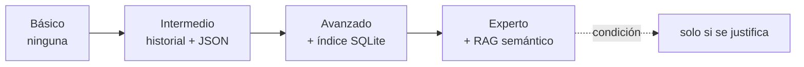
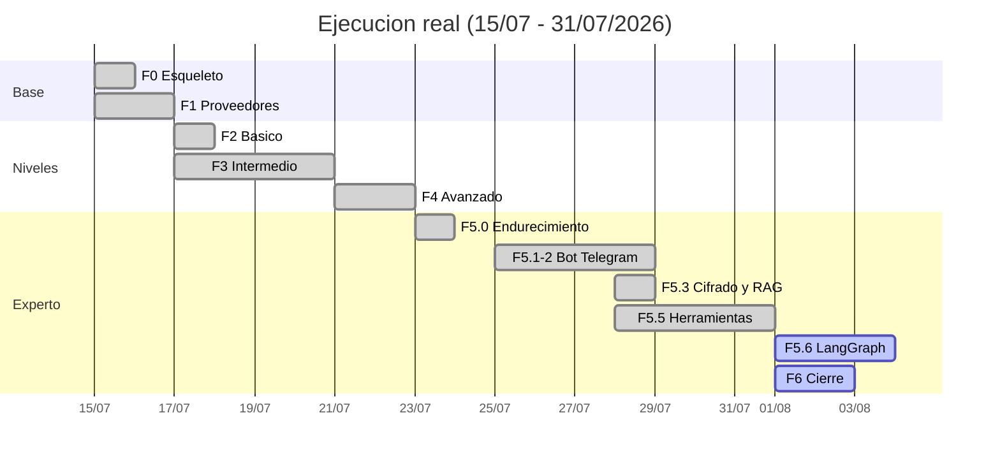

# E3 — Estado del Arte, Investigación y Plan de Fases
## JIMMY — Asistente personal con IA (CLI + Telegram)

**Versión:** 1.0
**Fecha:** 15/07/2026 (v0.1) → 21/07/2026 (v0.3) → 31/07/2026 (**v1.0**, cierre de Fase 5)
**Autor:** Jordi
**Estado:** Vigente

---

## Índice

1. [Criterio de selección: la privacidad decide](#1-criterio-de-selección-la-privacidad-decide)
2. [Proveedores LLM](#2-proveedores-llm)
3. [Qué es un agente, aprendido construyéndolo](#3-qué-es-un-agente-aprendido-construyéndolo)
4. [Frameworks de agentes](#4-frameworks-de-agentes)
5. [Memoria vectorial y embeddings](#5-memoria-vectorial-y-embeddings)
6. [Seguridad en agentes LLM](#6-seguridad-en-agentes-llm)
7. [Plan de fases y seguimiento real](#7-plan-de-fases-y-seguimiento-real)
8. [Índice de ADR](#8-índice-de-adr)
9. [Trabajo futuro](#9-trabajo-futuro-identificado)

---

## 1. Criterio de selección: la privacidad decide

Al planificar la Fase 5 investigué el estado del ecosistema de agentes (2026). El criterio
rector fue **RNF-06**: los datos no salen de la máquina salvo la llamada al LLM.

**La lección de fondo:** ese requisito no limitó el aprendizaje, lo dirigió. Obligó a
entender qué hace cada herramienta por dentro y **dónde acaban los datos**, en vez de
enchufar servicios en la nube a ciegas. Varias decisiones se toman solas al aplicarlo.

| Categoría | Candidatos | Decisión | Motivo |
|---|---|---|---|
| Observabilidad | LangSmith | ❌ | SaaS cerrado: manda prompts y respuestas completas a servidores de terceros |
| Observabilidad | Phoenix, Langfuse | ⏸️ | Locales, respetarían RNF-06, pero `logs/agente.log` basta hoy |
| Vector DB | Pinecone | ❌ | Nube y de pago: los embeddings de mis conversaciones saldrían de la máquina |
| Vector DB | ChromaDB · Qdrant · FAISS | ✅ **ChromaDB** | Las tres son locales; ChromaDB es la más simple para aprender |
| Embeddings | API de pago (OpenAI…) | ❌ | Cada mensaje viajaría a un tercero solo para vectorizarse |
| Embeddings | fastembed (ONNX, local) | ✅ | Corre en la máquina, sin red |
| Validación | Pydantic | ✅ | Librería local; endurece la validación de argumentos de las tools |
| Multi-agente | LangGraph · CrewAI · AutoGen | ❌ como base | El caso de uso es un agente único (§4.2). AutoGen además está en mantenimiento |

---

## 2. Proveedores LLM

### 2.1 La lección metodológica (15/07) — la que más ha valido

Pregunté a varias IA (Kimi, ChatGPT, Gemini) por modelos gratuitos con tool calling. **Las
tres citaron modelos ya retirados** ("Claude 3.5 Sonnet", "GPT-4o mini") como si estuvieran
vigentes.

**Conclusión, aplicada durante todo el proyecto:** los catálogos de modelos caducan en
semanas. Todo dato de disponibilidad, cuota o capacidad se **verifica contra documentación
oficial o probándolo**. Nunca contra lo que "sabe" un modelo.

Esta lección volvió a aplicarse dos veces más: al catálogo de herramientas (ADR-006, donde
descarté una tabla de riesgo generada por una IA externa) y a la auditoría de la lista
blanca de dominios (donde verifiqué por DNS los 36 dominios uno a uno).

### 2.2 Resultado de la comparativa

| Proveedor | Coste real | Tool calling | Decisión |
|---|---|---|---|
| **Groq** | Gratis, sin tarjeta | ✅ verificado | **Primario** |
| **Ollama Cloud** | Gratis con cuenta | ✅ verificado | **Fallback 1** |
| **Gemini** | Gratis (nivel free) | ✅ verificado | **Fallback 2** |
| Anthropic | De pago | ✅ | Contemplado, no implementado |
| OpenRouter | Modelos free rotativos | ⚠️ variable | Descartado: catálogo inestable |

Detalle y pruebas reales en [ADR-001](ADR/ADR-001-proveedor-llm.md).

---

## 3. Qué es un agente, aprendido construyéndolo

Un agente = **LLM + bucle + herramientas + memoria**. Lo aprendí implementándolo, y estos
son los hallazgos que solo aparecen escribiendo el código:

- **El modelo NO ejecuta código.** Decide que quiere llamar a una función descrita por
  nombre, descripción y JSON Schema. **El programa la ejecuta** y le devuelve el resultado.

- **El bucle es el mismo patrón en los 3 proveedores, pero cada uno lo implementa
  distinto** — verificado con código real, no con la documentación:

  | Proveedor | Argumentos | Identificación | Peculiaridad |
  |---|---|---|---|
  | Groq | JSON en **texto** (hay que parsear) | exige `tool_call_id` | Manda `null` cuando la tool no tiene parámetros |
  | Ollama | ya son **dict** | usa `tool_name` | — |
  | Gemini | dict | — | Declara tools **sin** el envoltorio `"type": "function"`, y puede repartir la petición en **cualquier `part`**, no siempre la primera (bug real encontrado en F4.6) |

- **La descripción de una tool es código, no comentario.** Condiciona si el modelo la elige
  bien. Dos tools que suenan parecido son la causa nº 1 de que elija mal — de ahí que
  `buscar_en_recuerdos` y `consultar_historial` **se nombren mutuamente** en su descripción
  ("si quieres el contenido, usa la otra").

- **Nunca asumir que los argumentos son correctos.** Un JSON mal formado o un parámetro
  inventado no puede tirar el programa. De ahí la validación Pydantic con `extra="forbid"`.

---

## 4. Frameworks de agentes

### 4.1 A mano vs framework

| Opción | A favor | En contra | Decisión |
|---|---|---|---|
| **A mano** | Se entiende cada pieza; sin dependencias que envejezcan | Más código propio | ✅ **Elegido** |
| LangChain | Ecosistema grande | Redundante con lo ya construido; esconde justo lo que quiero aprender | ❌ |
| LangGraph | Control de flujo explícito, checkpoints | Pensado para grafos multi-agente; aquí no hay grafo | ⏸️ Comparación futura (F5.6) |
| CrewAI | Prototipado rapidísimo | Abstracción alta: escondería el bucle de tools | ❌ |
| PydanticAI | Type safety | El agente ya está construido a mano | ⏸️ |

**Motivo real:** el objetivo es formativo. Un framework habría resuelto en 20 líneas
exactamente lo que había que entender.

### 4.2 ¿Un agente o varios?

Consideré multi-agente (orquestador + sub-agentes). **Descartado por un motivo técnico, no
por esfuerzo:** tener 30 herramientas es un problema de **organización de tools** (agrupar
y filtrar), no de **coordinación entre objetivos distintos**. Multi-agente resuelve lo
segundo; aplicado al primero solo añade complejidad, fragilidad y **más movimiento de datos
entre componentes** — o sea, peor privacidad.

La solución al problema real fue `/tools`: categorías activables bajo demanda (ADR-006).

> No confundir con la **cadena de fallback de proveedores** (ADR-004): eso es resiliencia de
> un agente único, no coordinación entre agentes distintos.

---

## 5. Memoria vectorial y embeddings

### 5.1 Memoria evolutiva (ADR-002)

La condición de ADR-002 era *"memoria semántica solo si se justifica"*. Se justificó: quiero
que recuerde lo hablado **días atrás**, buscando por significado en todo el histórico, no
recargar la última conversación.

### 5.2 Elección del modelo de embeddings

| Modelo | Tamaño | Veredicto |
|---|---|---|
| `all-MiniLM-L6-v2` | ~90 MB | ❌ El más citado en tutoriales, pero entrenado sobre todo en **inglés** — peor recuperación en conversaciones en español (RF-12) |
| `paraphrase-multilingual-MiniLM-L12-v2` | ~470 MB | ✅ Multilingüe, buen equilibrio para correr en local (o en una Raspberry Pi) |

### 5.3 Límite conocido del RAG (encontrado el 31/07, sin cerrar)

Cada mensaje se indexa **suelto**, así que la búsqueda empareja **pregunta con pregunta**.
Buscar *"¿cómo te llamas?"* devuelve otras veces que hice esa misma pregunta, no la
respuesta. El dato solo aparece si buscas el término que ya está en la respuesta — o sea,
**solo lo encuentras si ya sabes la respuesta**.

Mitigado en el prompt (se le obliga a admitir que no lo tiene si solo le salen preguntas).
El arreglo real es **indexar cada intercambio como pareja**. Anotado, no hecho.

---

## 6. Seguridad en agentes LLM

Referencia: **OWASP Top 10 for LLM Applications**. Lo que aplica aquí y cómo se cierra:

| Riesgo OWASP | Cómo se cierra en este proyecto | Estado |
|---|---|---|
| **LLM01 Prompt injection** | SEG-07: delimitar (`<fuente>`, `<recuerdo>`) + sanear + el prompt declara que lo citado es dato, nunca orden | ✅ |
| **LLM02 Manejo inseguro de salidas** | Validación Pydantic; mensajes de error propios, nunca volcados de Python | ✅ |
| **LLM04 Denegación de servicio** | Rate limit por usuario + presupuesto de 15 llamadas por turno + timeouts propios (8 s en tools) | ✅ |
| **LLM05 Cadena de suministro** | `pip-audit` en CI **sin** `continue-on-error`; lockfile; CVE conocida ignorada con motivo escrito | ✅ |
| **LLM06 Fuga de información** | Cifrado en reposo + logs de solo metadatos (**hubo incidencia real**, ver E1 §3.2) | ✅ |
| **LLM07 Plugins inseguros** | Cada tool declara capacidades; el riesgo se **calcula**; activación por categorías | ✅ |
| **LLM08 Agencia excesiva** | Ninguna tool con efectos externos todavía; la idempotencia por turno ya está lista para cuando la haya | ✅ |
| **LLM09 Exceso de confianza** | Avisos anti-alucinación **dentro del resultado** de la tool, en forma de prohibición | ✅ |
| **SSRF** (no está en el Top 10, pero es el riesgo real aquí) | Guardián propio: lista blanca + IPs internas + sin redirecciones | ✅ |

### 6.1 Doctrina propia: validación por mutación

Un test que **nunca has visto fallar** no demuestra nada: puede estar comprobando algo
trivialmente cierto. Por eso todo control crítico se rompe a propósito y se comprueba que
un test se pone rojo.

| Mutación aplicada | Resultado |
|---|---|
| Mover la puerta de la lista blanca al grupo 0 | 🔴 detectada |
| `block=False` en la puerta | 🔴 detectada — y salió que `handler.block` no es un `bool` sino un centinela `DefaultValue(True)` cuyo `repr` es `True` pero **no es** `True`: mi primer assert estaba mal escrito y el test lo destapó |
| Lista blanca ilegible tratada como "permitir a todos" | 🔴 detectada |
| `user_id` en claro en el log | 🔴 detectada |
| Quitar las comillas del `.env` multilínea | 🔴 detectada (bug real: el guardián se quedaba con **cero** dominios, en silencio) |
| Quitar el aviso de tamaño en el `.docx` | 🔴 detectada (bomba de descompresión real) |
| `netloc` en vez de `hostname` en el guardián | 🟢 **sobrevivió** → destapó un test flojo, reescrito con puerto explícito |
| Guarda de lista vacía | 🟢 **sobrevivió** → resultó ser solo un mensaje (`any()` sobre conjunto vacío ya es `False`) |

**Dos mutaciones sobrevivieron, y ese es el mayor valor de la técnica:** no encontraron
fallos en el código, encontraron **tests que no comprobaban lo que decían comprobar**.

### 6.2 Segunda doctrina: no fiarse de un "audit" pegado

Ni de una IA externa ni de otra sesión de trabajo. Todo informe de auditoría se verifica con
**evidencia real**: DNS resuelto, código ejecutado, llamadas reales a la API. Salió de aquí:
una propuesta de lista blanca "auditada" incluía `platform.openai.com/docs` — una **ruta** en
una lista que solo compara *hostnames*, así que nunca habría coincidido con nada.

---

## 7. Plan de fases y seguimiento real

| Fase | Planeado | Real | Entregable | Tag |
|---|---|---|---|---|
| 0 — Esqueleto | 15/07 | 15/07 | Repo + docs base + ADR-001 (hipótesis) | — |
| 1 — Validar proveedores | 15–17/07 | 15–16/07 | Smoke tests + ADR-001 (decisión) | — |
| 2 — Básico | 17–21/07 | **17/07** | Chat en bucle, errores manejados, logging | `nivel-basico` |
| 3 — Intermedio | 22–28/07 | **17–20/07** | Historial + prompt + persistencia + pytest | `nivel-intermedio` |
| 4 — Avanzado | 29/07–04/08 | **21–22/07** | Tool calling con bucle propio | `nivel-avanzado` |
| 5.0 — Endurecimiento | *no planeado* | 23/07 | Capa de proveedores + router (ADR-004) | — |
| 5.1–5.2 — Bot Telegram | 05–13/08 | 25–28/07 | Bot con dos puertas de seguridad (ADR-005) | — |
| 5.3 — Cifrado + RAG | 05–13/08 | 28/07 | Fernet + ChromaDB + memoria compartida | — |
| 5.5 — Herramientas | 05–13/08 | 28–31/07 | 7 herramientas + guardián + `/tools` (ADR-006) | — |
| 5.6 — Comparación LangGraph | opcional | ⏳ | Extra | — |
| 6 — Cierre y entrega | 13–14/08 | ⏳ | E4 + reflexión final | `nivel-experto` |

### 7.1 Diagrama de ejecución real

### 7.2 Sobre el adelanto

Las fases 2-4 se cerraron muy por delante del calendario (Fase 3 en 4 días de 7; Fase 4 en 2
de 7). **No es trabajo superficial:** cada fase tiene evidencia en el diario — llamadas
reales a los tres proveedores, bugs encontrados con reproducción, no solo teoría.

El tiempo sobrante se dedicó a **profundizar**, no a acumular adelanto: de ahí salieron la
auditoría de seguridad, F5.0 y la doctrina de validación por mutación.

**F5.0 no estaba planificada.** Nació de una auditoría y una revisión de código hechas **a
propósito antes** de tocar Telegram. Endurecer antes de exponer, no después.

---

## 8. Índice de ADR

| ADR | Título | Estado | Decisión en una línea |
|---|---|---|---|
| [001](ADR/ADR-001-proveedor-llm.md) | Proveedor LLM | Aceptado 16/07 | Groq → Ollama → Gemini, verificado con pruebas reales |
| [002](ADR/ADR-002-memoria-evolutiva.md) | Memoria evolutiva | Aceptado 20/07 | Escalar de JSON a RAG **solo cuando se justifique** |
| [003](ADR/ADR-003-framework-agente.md) | Framework vs a mano | Aceptado 22/07 | A mano, y **un solo agente** |
| [004](ADR/ADR-004-router-fallback.md) | Router de fallback | Aceptado 23/07 | Reintentos con backoff + degradación automática |
| [005](ADR/ADR-005-seguridad-bot-telegram.md) | Seguridad del bot | Aceptado 27/07 | Dos puertas en grupo −1, antes de cualquier handler |
| [006](ADR/ADR-006-catalogo-y-riesgo-de-herramientas.md) | Catálogo y riesgo de tools | Aceptado 28/07 | El riesgo se **calcula** desde capacidades declaradas |

---

## 9. Trabajo futuro identificado

| Tema | Estado | Nota |
|---|---|---|
| Voz (`/voz`) | Siguiente | Whisper por Groq para escuchar + **Piper local** para hablar. **La voz es dato biométrico**: identifica a la persona, no solo lo que dice |
| Búsqueda web (Tavily) | Evaluado, no implementado | 1.000/mes sin tarjeta; al agotarse deja de responder, no cobra |
| Obsidian (notas locales) | Evaluado, no implementado | Estrenaría `escribe_disco`: validar rutas por allowlist, como en `/borrar` |
| Outlook (calendario) | Evaluado, no implementado | Refresh token de 90 días (Google caduca a los 7 → descartado). **Única que sacaría datos personales: matizaría RNF-06** |
| Comparación con LangGraph | Pendiente (F5.6) | Reimplementar el router como grafo y comparar honestamente |
| Indexar pares pregunta-respuesta | Pendiente | Cierra el límite del RAG (§5.3) |
| Trocear documentos largos | Pendiente | 8.000 caracteres son el 10 % de unos apuntes de 75.000 |
| Particionar el RAG por usuario | Pendiente | Hoy el bot **no arranca** con más de un `user_id`, a propósito |
| Hosting 24/7 | Abierto | Si va a VPS, ChromaDB sigue **embebido**, nunca como servicio (CVE-2026-45829) |

**Descartadas con motivo:** Wikipedia (redundante con Tavily; dos tools de "buscar" es la
ambigüedad que peor precisión produce) · resumir/traducir como tool (el modelo ya sabe
hacerlo sin salir a ningún sitio) · Google Calendar (token de 7 días en modo Testing) ·
Brave (exige tarjeta) · Google Custom Search (cerrada a clientes nuevos) · DuckDuckGo (no
existe API de búsqueda; `ddgs` es un scraper que en su propio README admite que puede violar
los ToS) · SearXNG (exige un VPS que no existe; y con un solo usuario su ventaja de
privacidad es débil — la IP del servidor eres tú) · AEMET (Open-Meteo ya lo cubre sin clave).

---

*E3 — Estado del Arte, Investigación y Plan de Fases v1.0 · 31/07/2026*
